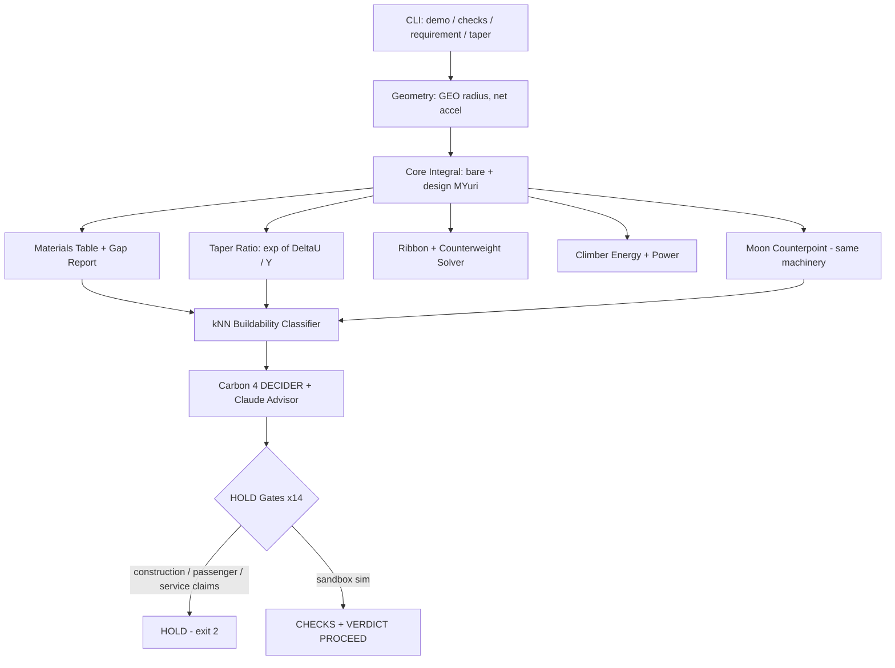
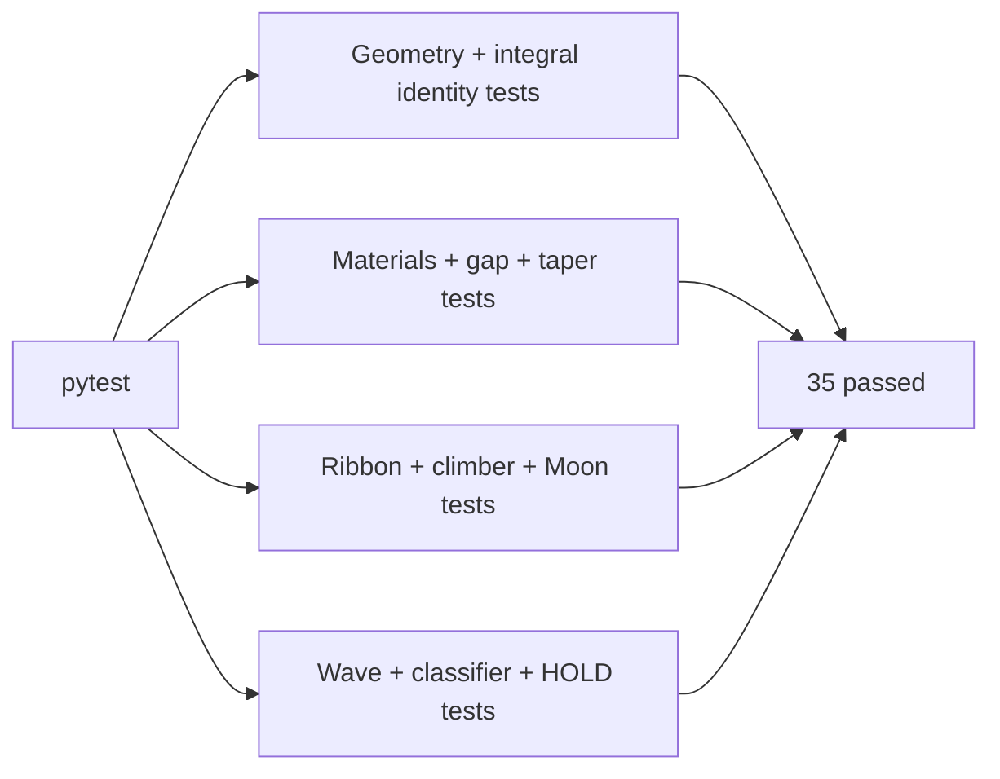
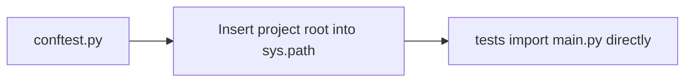
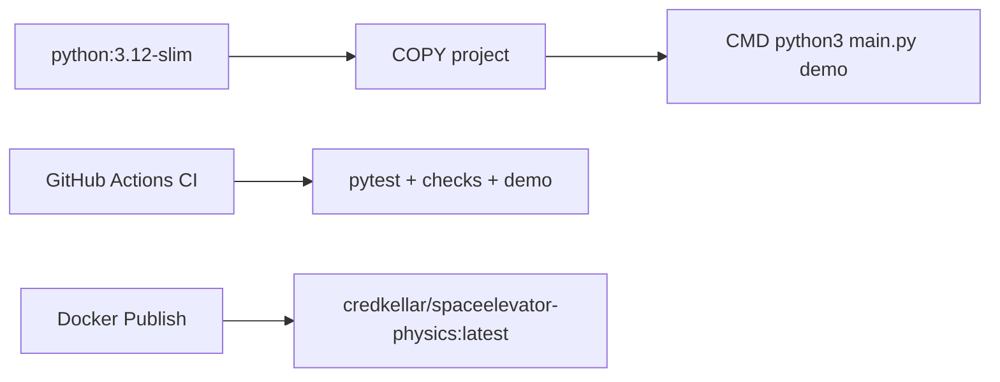

# SpaceElevator-Physics 🛰️🧗

**Space Elevator Tether Physics Lab** — an educational space-elevator physics lab in ONE pure-Python file, by Darion Kellar. The **core integral** — effective gravity integrated along the tether — sets the specific-strength bar: **48.42 MYuri bare for Earth, 62.95 MYuri with the standard 1.3 design safety factor** (labelled). Against that bar the lab lays the **materials table** (steel, Kevlar, carbon fibre, Zylon, today's CNT yarn, the theoretical single nanotube), the **taper-ratio** formula, a labelled **ribbon + counterweight** model, **climber energy** arithmetic, and the **lunar counterpoint**: the same integral on the Moon asks for only **2.74 MYuri**. The honest headline: **this lab computes WHY no Earth elevator can be built today** — even a perfect nanotube only just clears the bare bar, and the best manufacturable yarn is ~21× short. Simulation and learning only — every construction, service, and passenger claim sits behind a permanent HOLD gate (14 total). 🔒


> ℹ️ The two workflow badges above are the **live** GitHub Actions badges for this repo — they light up as soon as the `ci.yml` and `docker-publish.yml` files from the paste pack are pasted into `.github/workflows/`.

## 🧰 Tech Stack Badges & Full Architecture Tech Stack

### 💻 Core Programming Languages & Core Systems


- 🐍 Python 3.12, pure standard library (`math`, `hashlib`, `json`, `sys`) — ONE file: `main.py`
- 🌀 Physics core: synchronous-orbit geometry, the specific-strength requirement integral computed BOTH in closed form and by Simpson quadrature (asserted to agree), taper-ratio exponentials, a constant-stress tapered-ribbon solver with counterweight balance, climber energy/power arithmetic, tension-wave speed
- 🧠 TinyML kNN buildability classifier (from scratch, stdlib) on (log₁₀ ΔU/Y, theoretical flag), with a training grid generated from the stated labelling rule
- 🧑‍⚖️ Advisory seats inside `main.py`: Gemini Carbon 4 DECIDER (names-only, tighten-only, sha256 trace), Muse advisor (can_override_hold = False), Google Flow plan-only (rendered = False, live = 0)

### ⛓️ Web3 & Infrastructure

Not used — this lab is an offline physics simulation. No blockchain, no Web3 libraries, no network calls of any kind.

### ⚙️ Platform Support & Hardware Architecture


- 🖥️ Runs anywhere Python 3.12 runs — Linux, macOS, Windows, any CPU architecture
- 🚫 Controls **no hardware**: no tethers, climbers, anchor stations, or counterweights (all behind HOLD gates)

### ⚡ Low-Level Infrastructure & Performance


- 🚀 Zero dependencies, zero network, zero install friction for the lab itself
- 🎯 Deterministic end to end: run it twice, get byte-identical output
- 🔢 The only iteration is fixed-step Simpson quadrature and the kNN sort — no solvers that can wander

### 🛠️ DevOps & Build Tools


- 🐳 Docker image (`python:3.12-slim`), target: `credkellar/spaceelevator-physics:latest`
- ⚙️ GitHub Actions CI + Docker Publish workflows — delivered in the paste pack for `.github/workflows/`

### ☁️ Cloud Providers

Not used — this lab runs fully offline on your own machine or in a local Docker container. No cloud account, no API keys, no hosted services.

## What this does?

1. 🌍 **Geometry first** — the synchronous (GEO) radius falls out of (μ/ω²)^⅓: **42,164 km from Earth's centre, 35,786 km above the equator**, with net acceleration exactly zero there, inward below (surface effective gravity 9.77 m/s²), outward above. The part beyond GEO is what holds the ribbon taut.
2. ∫ **The core integral** — for a uniform tether, tension peaks at GEO at exactly ∫(μ/r² − ω²r)dr from the surface: **48.42 MYuri bare**. The lab computes it in closed form AND by Simpson quadrature and asserts they agree — the bar is an integral, not a slogan. With the labelled 1.3 design safety factor: **62.95 MYuri**.
3. 🧪 **Materials table, labelled** — specific strength Y = σ/ρ in MYuri (1 GPa per g/cm³ = 1 MJ/kg = 1 MYuri): structural steel 0.06, best steel wire 0.20, Kevlar-49 2.50, carbon fibre 3.54, Zylon 3.72, typical CNT yarn 1.00, best CNT yarn 3.00, theoretical single nanotube 62.90.
4. 🚫 **THE GAP — the headline** — against the 62.95 MYuri design bar: steel wire is **315× short**, Kevlar 25×, the best real CNT yarn **21× short**. The theoretical nanotube clears the *bare* bar (48.42) and still **fails the design bar**. Why CNTs aren't enough *yet* is a manufacturing gap — defect-free microns vs defect-scaled kilometres — and this lab measures it.
5. 📐 **Taper ratio** — the rocket-equation twin A(GEO)/A(surface) = exp(ΔU/Y): steel's Earth taper is **10^105** (a ribbon wider than galaxies), the theoretical nanotube's is **2.16** (conceivable on paper). Same formula, two universes.
6. 🎗️ **Ribbon + counterweight (labelled model)** — a constant-stress tapered ribbon of theoretical CNT (ρ = 1300 kg/m³, worked at full specific strength, carrying a 20,000 kg climber at the surface): fattest at GEO (5.16×10⁻⁶ m²), tension at GEO 4.22×10⁵ N, total ribbon mass **≈ 598 tonnes**, and a **≈ 582 tonne** counterweight at 106,378 km on a 100,000 km tether. Labelled model — not a build plan.
7. 🧗 **Climber energy** — in the rotating frame the climb to GEO costs *exactly the same integral*: **48.42 MJ/kg**, so a 20 t climber needs **269 MWh**, takes **7.46 days at 200 km/h** (labelled), peaks at 542 W/kg (10.85 MW) at departure, and a 50%-efficient beamed-power supply (labelled) must roughly double that.
8. 🌙 **The Moon counterpoint** — identical machinery, lunar constants: the bar collapses to **2.74 MYuri (17.7× lower)**. Kevlar's lunar taper is 2.99, best CNT yarn's 2.49 — single digits, buildable class. Honest caveat, labelled: the lunar synchronous radius (88,465 km) lies beyond L1 (~58,000 km), so real lunar designs anchor at L1.
9. 🌊 **Oscillation note (brief)** — a tension wave runs at √(σ/ρ) = √Y: 7,931 m/s on theoretical CNT, ~3.5 h to cross the tether. The ribbon answers disturbances slowly; climber Coriolis sway is noted, not simulated.
10. 🏷️ **kNN buildability classifier** — labels any (material, body) pair `buildable-today` / `needs-theoretical-material` / `hopeless`, trained on a grid generated from the stated rule: Earth+steel → hopeless, Earth+theoretical CNT → needs-theoretical-material, Moon+Kevlar → buildable-today.
11. 🧠 **Advisory seats + checks** — Carbon 4 DECIDER with sha256 trace, Muse advisor, Google Flow plan-only, and a built-in CHECKS suite (65 checks).

## 🗺️ How it works — diagram per script

### `main.py` — the whole lab



### `tests/test_main.py` — verification



### `conftest.py` — test path setup



### `Dockerfile` + CI — container & workflow flow



## Why is this cool?

1. 🛰️ The whole impossible machine hangs on one integral. Integrate effective gravity from the ground to GEO and you get the exact material property the ribbon needs — no hand-waving, a number: 48.42 MYuri.
2. 📏 The unit is a gift: 1 GPa per (g/cm³) = 1 MJ/kg = 1 MYuri, so the climber's energy bill and the material's strength are literally the same number wearing two hats — and the lab asserts the identity.
3. 🧵 The nanotube paradox, measured: the theoretical tube (62.90) clears the bare bar and fails the design bar (62.95) in the same table. "Almost" has never been this precise.
4. 🏭 It names the real villain — not chemistry, *manufacturing*. A defect-free micron of nanotube is a wonder; a kilometre of yarn is 21× too weak, because strength dies by defects and length.
5. 📐 Steel's taper ratio has 105 digits. The exponential exp(ΔU/Y) turns "steel is 300× too weak" into "the ribbon's top would outweigh galaxies" — the fastest honest summary of the field.
6. 🌙 The Moon flips the verdict with the same code: change three constants and the bar drops 17.7×, into fibres that already exist. Hope, but computed.
7. 🎗️ Even the fantasy ribbon is heavy: grant the theoretical material and the labelled model still needs ~598 t of ribbon and a ~582 t counterweight. Optimism, audited.
8. 🔋 The power bill is real arithmetic: 269 MWh and ~7.5 days per 20 t climber at 200 km/h, peaking at 10.85 MW the moment it leaves the ground.
9. 🌊 The ribbon is *slow*: a tension wave needs 3.5 hours to cross it. A 100,000 km structure answers insults at walking pace, and the lab shows why from √Y.
10. 🎯 Deterministic end to end: run it twice, get byte-identical output — space-elevator physics you can diff.

## What problems this solves?

1. ❌ **Problem:** "Carbon nanotubes are strong enough for a space elevator" is repeated as settled fact. ✅ **Solution:** The gap table puts the theoretical tube, the best real yarn, and the design bar in one view: tube clears bare, fails design; yarn is 21× short. The claim survives only by confusing a micron with a megastructure.
2. ❌ **Problem:** The specific-strength requirement gets quoted as a magic constant with no derivation. ✅ **Solution:** The requirement is computed two independent ways (closed form and Simpson quadrature) and asserted to agree — anyone can re-derive the bar from μ, ω, and R.
3. ❌ **Problem:** Bare-minimum numbers get used as engineering targets. ✅ **Solution:** Bare (48.42) and design (62.95, with the labelled 1.3 safety factor) requirements are reported separately, and materials are graded against both.
4. ❌ **Problem:** Taper is mentioned but never sized. ✅ **Solution:** exp(ΔU/Y) is evaluated for every material on both bodies — steel at 10^105 vs the nanotube at 2.16 makes feasibility visceral.
5. ❌ **Problem:** Ribbon mass and counterweight mass are hand-waved. ✅ **Solution:** A constant-stress tapered-ribbon model with stated assumptions integrates the profile both ways from GEO and balances the counterweight explicitly.
6. ❌ **Problem:** Climber energy is quoted without the trip or the power peak. ✅ **Solution:** Energy per kg, total MWh, trip days at a labelled speed, peak vs average W/kg, and the beamed-power multiplier are all printed from the same integral.
7. ❌ **Problem:** "Lunar elevators are feasible" sounds like hype next to Earth's verdict. ✅ **Solution:** The identical machinery on lunar constants shows the bar really is 17.7× lower — and the L1 caveat is printed with it, so the hope is honest.
8. ❌ **Problem:** Ribbon dynamics get ignored until they break designs. ✅ **Solution:** The wave-speed module computes the 3.5 h signal crossing and names Coriolis sway as an open, labelled problem instead of hiding it.
9. ❌ **Problem:** Physics code usually needs numpy / scipy installs. ✅ **Solution:** Pure standard library — runs anywhere Python 3.12 runs, zero pip installs for the lab itself.
10. ❌ **Problem:** Simulation tools quietly imply engineering readiness. ✅ **Solution:** Model constants are labelled as model values, the ribbon is labelled a model, and 14 HOLD gates return exit code 2 for every construction, passenger, and service claim.

## How to install this?

1. 📋 Clone or download this project folder.
2. 🐍 Make sure Python 3.12+ is installed: `python3 --version`
3. ▶️ Run the full demo + checks (no arguments needed):

```bash
python3 main.py
```

4. 🧪 Run the test suite:

```bash
pip install pytest
python3 -m pytest -q
```

5. 🎛️ Try the other commands:

```bash
python3 main.py checks     # 65 built-in checks
python3 main.py geometry   # GEO radius / altitude / surface gravity as JSON
python3 main.py requirement # Earth + Moon requirement integrals as JSON
python3 main.py materials  # the materials table as JSON
python3 main.py gap        # how many x short of the bar, per material
python3 main.py taper      # taper ratios for Earth + Moon as JSON
python3 main.py ribbon     # labelled ribbon + counterweight model as JSON
python3 main.py climber    # climber energy / power / trip time as JSON
python3 main.py moon       # the lunar counterpoint as JSON
python3 main.py wave       # tension-wave speed + crossing time as JSON
python3 main.py classify   # kNN buildability verdicts
python3 main.py brains     # Carbon 4 + Muse + Flow seats
python3 main.py holds      # list all 14 HOLD gates
python3 main.py hold-demo  # exits 2 - gated actions stay HOLD
```

6. 🐳 Or run it in Docker:

```bash
docker build -t credkellar/spaceelevator-physics:latest .
docker run --rm credkellar/spaceelevator-physics:latest
```

## Requirements

- 🐍 Python 3.12 or newer
- 📦 Dependencies: **none** (standard library only)
- 🌐 Network: **none** — fully offline
- 🧪 For tests only: `pytest`
- 🐳 Optional: Docker

## FULL project structure tree

```text
spaceelevator-physics/
├── main.py                  # the whole lab: geometry, requirement integral, materials + gap, taper, ribbon + counterweight, climber, Moon, wave note, classifier, seats, HOLD gates
├── conftest.py              # puts the project root on sys.path for tests
├── tests/
│   └── test_main.py         # 35 pytest tests: geometry, integral identity, materials, gap, taper, ribbon, climber, Moon, wave, gates, determinism
├── assets/
│   └── cover.png            # README cover image (2736 x 912)
├── Dockerfile               # python:3.12-slim, runs the demo
├── .gitignore               # __pycache__, .pytest_cache, *.pyc
└── README.md                # this file
```

> 📦 Delivered separately as paste packs (not in this tree): `.github/workflows/ci.yml` + `docker-publish.yml`, and the Docker Hub pack (100-char description, 350-char About, overview, categories).

## 🔒 HOLD gates — all 14, permanent

| Gate | Rule |
|---|---|
| construction_feasibility_claim | No material that exists today can build an Earth elevator; this lab computes why, it does not green-light a build |
| real_hardware_control | No control of any real tether, climber, anchor station, or counterweight hardware, ever |
| live_deployment_guidance | No instructions for deploying, anchoring, or tensioning a real tether; this lab computes, it does not operate |
| commercial_service_claim | Educational lab, not a commercial elevator service or product design |
| passenger_transport_claim | No claim that people can ride; the climber model is cargo arithmetic, not a safety case |
| investment_claim | No investment advice about space-elevator, nanotube, or launch companies |
| guaranteed_performance_claim | No guaranteed performance; every model carries its labelled assumptions |
| material_synthesis_recipe | No nanotube synthesis recipes aimed at "reaching" theoretical strength values |
| counterweight_capture_guidance | No asteroid capture, redirect, or counterweight emplacement guidance |
| weapons_application_claim | No weapons application guidance of any kind |
| collision_avoidance_live | No live orbital-debris tracking or ribbon collision-avoidance operations |
| lunar_construction_claim | The lunar numbers are a labelled model too, not a lunar build plan |
| power_export_claim | No claim the elevator exports net energy or runs a power-beaming service |
| peer_reviewed_result_claim | No peer-reviewed-result claim; these are textbook-model computations |

🧑‍⚖️ **Seats:** Gemini Carbon 4 DECIDER (MAP→MODEL→STRESS→DECIDE, names-only, tighten-only, sha256 trace) · Muse advisor (can_override_hold = False) · Google Flow plan-only (rendered = False, live = 0).

✅ **Verification:** pytest 35 passed · CHECKS 65/65 · double-run byte-identical · hold-demo exits 2.

## 🧒 5th-grade English section

Imagine a rope hanging from the sky. The top of the rope is so far away that Earth spinning tries to fling it off into space — and that flinging is exactly what holds the rope tight, like a weight on a string you swing around your head. 🎡

- To climb into space without a rocket, you could ride a little elevator car up the rope. 🚀
- But the rope has a problem: it is **heavy**, and it is 100,000 kilometres long. The middle of the rope has to hold up *all* the rope below it.
- Scientists measure rope strength with a score called **specific strength** — how strong something is for how light it is. Earth demands a score of about **63**. 📏
- Steel scores about **0.2**. The best real carbon-nanotube yarn scores about **3**. Even the strongest rope material we can actually make is more than **20 times too weak**. 😮
- One single perfect nanotube — thinner than a hair, too tiny to see — scores about **63**. But nobody can weave a rope out of single perfect tubes yet, and longer tubes collect tiny flaws that make them weak.
- The **Moon** is smaller and pulls weaker, so there the score needed is only about **3** — ropes we already have might just barely work there! 🌙
- This project is a **pretend lab on a computer**. It does the math of the sky rope — it does not build one. 💻

---

MIT © 2026 Darion Kellar · SpaceElevator-Physics — educational simulation only 🛰️
